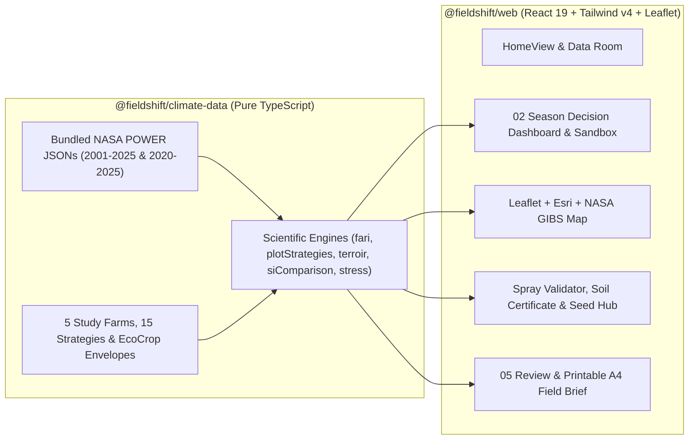

# FieldShift — Adapting Farms with NASA Earth Observation Data

[](https://field-shift-nasaspaceapps-theta.vercel.app/)
[](https://www.spaceappschallenge.org/)
[](https://power.larc.nasa.gov/)
[](./tsconfig.base.json)

> **Live Application:** [**https://field-shift-nasaspaceapps-theta.vercel.app/**](https://field-shift-nasaspaceapps-theta.vercel.app/)  
> **Team:** Team Overachiever · Cebu Institute of Technology – University (CIT-U), Cebu, Philippines  
> **Challenge Theme:** *The Next Frontier*

---

## 1. Overview

For smallholder farming families in **Nueva Ecija**, **Bukidnon**, **Isabela**, and **Guimaras**, a planting calendar is closely tied to production loans, irrigation schedules, trader advances, and household food security. Switching an entire field to an unfamiliar crop carries high financial risk when seed supply, local buyers, and seasonal rainfall are uncertain.

**FieldShift** is an open agricultural decision-support web application that connects **multi-decade NASA climate records (2001–2025)**, **satellite imagery layers**, and **crop climate envelopes** to practical relay-intercropping and crop-rotation choices:

```text
Observe Seasonal Signals  ──►  Compare Low-Risk Rotations  ──►  Verify Locally on the Farm
```

### Key Capabilities
- **Historical & Near-Real-Time Earth Data (No API Keys Required):** Bundled 2001–2025 NASA POWER climate normals, 2020–2025 monthly point series, and 2020–2025 daily extreme-event summaries (`T2M`, `T2M_MAX`, `T2M_MIN`, `PRECTOTCORR`, `IMERG_PRECTOT`, `GWETROOT`, `GWETTOP`, `RH2M`, `ALLSKY_SFC_SW_DWN`), paired with live NASA GIBS WMS map layers (`SMAP L4`, `Terra MODIS NDVI`, `GPM IMERG`), live **Copernicus Sentinel-2 L2A** point sampling, and live **Open-Meteo** 3-day weather outlooks.
- **Explicit Data Provenance & Scientific Guardrails:** Every dataset, map layer, and analytical output is labeled by data status (`observed`, `satellite`, `derived`, `static-baseline`, `modeled`, `illustrative`). Orbital suitability assessments are **capped at 80% confidence**, reserving **20% for on-farm ground-truth verification** (soil pH, plant-available N-P-K, organic matter, and texture).
- **Multi-Criteria Rotation Scoring (FARI):** Evaluates strategies across **Water (`W`)**, **Erosion (`E`)**, **Nutrients (`N`)**, and **Market (`M`)** using farmer-defined priority weights and climate stress scenarios. The existing baseline practice (`S1`) is scored with the exact same equations as adaptive rotations (`S2`, `S3`).
- **Field-Ready Accessibility & Export:** Includes a **Farmer Plain-English vs. Technical Mode** toggle, **Web Speech API voice readout**, **one-click SMS / Messenger field brief copy**, **open-pollinated / farmer-saved seed fallback options**, and an **A4 printable field planning brief** for Municipal Agriculture Office (MAO) and extension consultations.

---

## 2. Workspace Guide

The application is organized into an open Data Room on the landing page and a 5-step planning workspace:

| Section | Purpose & Interactive Controls |
| :--- | :--- |
| **Landing Page** | Overview of the three-step planning workflow and an expandable **Open Data Room** documenting all 13 connected datasets, their spatial/temporal resolutions, source links, and operational limits. |
| **`01 Farm`** | Select one of **5 study locations** (4 Philippine farming regions and 1 Central Illinois benchmark). Updates coordinates, elevation, SRTM-referenced slope context, soil baseline, and baseline cropping system. |
| **`02 Season`** | Unified **Field Decision Dashboard**:<br>• Switch **Month (`Jan`–`Dec`)**, toggle **Farmer Plain-English / Technical Mode**, use **Read Aloud**, or **Copy SMS Field Brief**.<br>• Inspect the **4 KPI Cards** (Air Temperature, Daily Rainfall, Root-Zone Soil Moisture `0–100 cm`, and Top FARI Score).<br>• Navigate across four evidence views:<br>  1. **`Map & 12-month pattern`**: Side-by-side **Esri/Leaflet Satellite Map** (with **Fullscreen** mode, **Before/After Split View**, and **5 telemetry overlays**), **Live Open-Meteo 3-Day Outlook**, and **12-Month NASA POWER Climatology Chart**.<br>  2. **`Quick strategy sandbox`**: Adjust priority sliders and toggle **Drought (`−20% Rain`)**, **Heatwave (`+2°C`)**, and **Local Seed Fallback** to compare 4 plot strategy archetypes and the **Urea & Nitrogen Application Risk Banner**.<br>  3. **`Spray risk & terroir`**: Inspect the **90-Day Climatological Flower Induction (CFI) & Spray Validator**, **Cold/Frost & Heat Check**, **Terroir Nutrient Gap Table**, **Approach A (25-Yr Z-Score) vs. Approach B (80/20 Ensemble)**, **Two-Tier Soil Certificate** (with live **Sentinel-2 10 m NDVI** point check), **Seed Hub**, **Forage & Market Economics**, and **FAO EcoCrop Envelopes**.<br>  4. **`Data & export`**: Download the raw **NASA POWER JSON** for the active location or a derived **CSV summary** across all five study farms. |
| **`03 Priorities`** | Configure **Farmer Priority Weights (`W, E, N, M`)**, **Field Reality Constraints** (`Rainfed Only`, `Manual Tools Only`, `Fast 60-Day Cash`), and **Climate Stress Scenarios** (`Baseline`, `Drought −30%`, `Heatwave +2.5°C`, `Deluge +40%`). |
| **`04 Rotations`** | Side-by-side comparison of **Strategies S1, S2, and S3** with full agronomic explanations (*Why Suggested*, *Supporting NASA Evidence*, *Expected Benefits*, *Data Gaps*, *Risks Requiring Local Review*), a **12-Month Ground Cover & Pest-Break Calendar**, and **Literature-Range Projected Impact Cards**. |
| **`05 Review`** | Summary of the selected draft rotation and one-click printing for the **8-section A4 Field Planning Brief**. |

---

## 3. Five Study Locations & 15 Crop-Rotation Strategies

FieldShift includes five representative agricultural study locations, each configured with three 12-month strategies (`S1` Baseline, `S2` Legume Soil Regenerator, `S3` Climate-Resilient Cash/Armor):

| Farm ID & Region | Coordinates · Elev · Slope | Soil Context | `S1` Baseline Practice | `S2` Soil & Moisture Regenerator | `S3` Climate-Resilient Cash / Armor |
| :--- | :--- | :--- | :--- | :--- | :--- |
| **`nueva-ecija`**<br>Muñoz–Talavera Plain, Central Luzon, PH | `15.680°N, 120.890°E`<br>107.6 m · **1.5% slope** | Maligaya Clay Loam | Wet-Season Irrigated Rice → Dry-Season Rice → Bare Summer Fallow | Wet-Season Rice → **60-Day Mungbean Relay** → Mulched Dry-Season Transition | Wet-Season Rice → **Short-Duration Onion / Sweet Potato (Camote) Relay** → Cowpea Cover |
| **`bukidnon`**<br>Malaybalay–Valencia Plateau, Mindanao, PH | `8.150°N, 125.120°E`<br>889.5 m · **11.0% slope** | Adtuyon Volcano-Alluvial Clay | Continuous Up-and-Down Slope Yellow Corn Monoculture | Contour Yellow Corn + **Arachis pintoi / Cowpea Living Mulch** | Contour Corn → **Sweet Potato (Camote) + Pigeon Pea Hedgerow Strips** |
| **`isabela`**<br>Cauayan–Ilagan Basin, Cagayan Valley, PH | `16.975°N, 121.810°E`<br>133.8 m · **2.2% slope** | Cauayan Alluvial Sandy Clay Loam | Two-Season Hybrid Yellow Corn Monoculture + Dry Fallow | Hybrid Corn → **Heat-Tolerant Mungbean / Peanut Relay** | **Dwarf Sorghum + Ridged Sweet Potato (Camote)** Typhoon-Resilient Relay |
| **`guimaras`**<br>Buenavista Orchard Belt, Western Visayas, PH | `10.583°N, 122.617°E`<br>68.0 m · **6.5% slope** | Guimaras gravelly loam over limestone | Clean-Weeded Carabao Mango Orchard + Routine KNO₃ Flower Induction | Carabao Mango + **Under-Canopy Peanut / Calopogonium Nitrogen Cover** | Carabao Mango + **Contour Vetiver / Sweet Potato Mulch & Climatological Spray Timing** |
| **`usa-midwest`** *(Benchmark)*<br>Central Illinois Corn Belt, USA | `40.100°N, 88.200°W`<br>220.0 m · **1.2% slope** | Flanagan/Drummer Mollisol Silt Loam | Continuous Conventional-Till Corn Monoculture | **Corn–Soybean Rotation + Winter Cereal Rye Cover Crop** | Corn → **Soybean + Crimson Clover / Radish Multi-Species Bio-Strip** |

---

## 4. Methodology & Scoring

All calculations are implemented in [`packages/climate-data/src/engine/`](./packages/climate-data/src/engine/) as pure, deterministic TypeScript functions with zero DOM or React dependencies.

### 4.1 Field Adaptation & Resilience Index (`FARI` on a 0–100 Scale)

Given raw priority weights `(r_W, r_E, r_N, r_M)` from `0` to `100`, FieldShift normalizes the weights so they sum to `1.0` (falling back to `0.25` each when all sliders are set to `0`):

```text
w_i  = r_i / (r_W + r_E + r_N + r_M)
FARI = clamp(100 × (w_W·W + w_E·E + w_N·N + w_M·M), 0, 100)
```

Each pillar `W, E, N, M` is bounded to `[0, 1]`:

1. **Water Alignment (`W`):**
   ```text
   W = clamp(0.42·M_supply + 0.33·R_align + 0.25·(1 − D_mismatch) − P_drought − P_heat − P_rainfed, 0, 1)
   ```
   Combines root-zone moisture availability (`GWETROOT`), rainfall adequacy, root-depth alignment (`rootDepthCm` vs. moisture-dependent target depth), water-demand mismatch, and drought/heat/rainfed stress penalties.

2. **Erosion & Slope Protection (`E`):**
   ```text
   E = clamp(1 − H_runoff × (1 − 0.72·S_armor) − P_deluge, 0, 1)
   ```
   Balances slope and 95th-percentile daily rain-burst exposure (`slopePct`, `adjustedRainBurstMm`) against canopy closure speed (`canopyClosureDays`), surface residue (`residueMulch`), root anchorage, and contour strips (`contourFactor`).

3. **Nutrient Cycling & Soil Regeneration (`N`):**
   ```text
   N = clamp(0.50·(nFixKgHa / 80) + 0.35·residueMulch + 0.15·B_topsoil, 0, 1)
   ```
   Combines modeled biological nitrogen fixation (`nFixKgHa`), organic residue mulch return (`residueMulch`), and topsoil moisture protection (`GWETTOP`).

4. **Market & Household Viability (`M`):**
   ```text
   M = clamp(0.38·priceIndex + 0.27·T_cash + 0.20·forageValue + 0.15·A_market − P_constraints, 0, 1)
   ```
   Integrates relative crop price index, cash turnaround speed (`cashTurnaroundDays`), livestock forage utility (`forageValue`), regional market access, and operating constraint penalties (`manualToolsOnly`, `fastCashNeeded`).

### 4.2 Satellite Intelligence (SI) Dual-Approach Comparison
- **Approach A — 25-Year Z-Score Anomaly Decomposition (`2001–2025`):**
  Computes standardized monthly anomalies across `GWETROOT`, `GWETTOP`, `T2M`, `PRECTOTCORR`, and `ALLSKY_SFC_SW_DWN`:
  ```text
  Z = (X_2020_2025 − μ_2001_2025) / max(σ_2001_2025, 0.01)
  ```
- **Approach B — Rule-Based Suitability Ensemble & Two-Tier Soil Certificate:**
  Evaluates suitability rules across moisture stability, slope erosion control, thermal window, and biological N regeneration. Orbital confidence is **capped at 80%** (`round(80% × Sample Completeness)`), reserving **20% for Tier 2 Ground-Truth Field Kit Verification** (measured pH, available N-P-K, organic matter, and field-verified soil texture).

### 4.3 Terroir Nutrient Balance & 90-Day Spray / Urea Risk Screening
- **Terroir Nutrient Gap Calculator:**
  ```text
  Δ Adjustment = Target Ideal Profile − (Regional Soil Baseline + Cover-Crop Biological Contribution)
  ```
- **90-Day Climatological Flower Induction (CFI) & Urea Application Screen:**
  Evaluates three consecutive calendar months using 2020–2025 daily event frequencies:
  - **Red (Washout / Leaching Risk):** `≥ 4.0` heavy storm days/month (`≥ 14 mm/day`) or mean precipitation `≥ 8.0 mm/day`. Advises holding KNO₃ foliar sprays and synthetic urea top-dressing.
  - **Amber (Thermal / Cold / Moisture Caution):** `≥ 8.0` heat-stress days (`≥ 33°C`), `≥ 2.0` cold days (`≤ 2°C`), or `GWETROOT < 0.45`. Advises split N application and early-morning spraying (`5:30–8:00 AM`).
  - **Green (Favorable Climatological Window):** Low historical storm frequency and balanced root-zone moisture; reminds the user to confirm the 24-hour local weather forecast before spraying.

---

## 5. Data Sources & Scientific Guardrails

| Dataset / Provider | Parameters / Layer | Resolution & Coverage | Role in FieldShift | Operational Limit & Guardrail |
| :--- | :--- | :--- | :--- | :--- |
| **NASA POWER**<br>*(MERRA-2 & CERES/SYN1deg)* | `T2M`, `T2M_MAX`, `T2M_MIN`, `PRECTOTCORR`, `GWETROOT`, `GWETTOP`, `RH2M`, `ALLSKY_SFC_SW_DWN` | Point-scale gridded (`~0.5° × 0.625°`) · Monthly `2001–2025` & Daily `2020–2025` | **Core FARI, Z-Score & CFI Engine Input** (`static-baseline`) | Gridded regional baseline; does not resolve within-field micro-topography or predict short-term weather. |
| **NASA GPM IMERG** | `IMERG_PRECTOT` + NASA GIBS WMS Precipitation Rate | `0.1°` (~10 km) · Monthly/daily series + 30-min WMS imagery | **Decision Input + Map Layer** (`satellite`) | Satellite-estimated area rainfall; does not replace an on-farm rain gauge or local 24-hour forecast. |
| **NASA SMAP L4** | `SMAP_L4_Analyzed_Surface_Soil_Moisture` (GIBS WMS) | `~9 km` EASE-Grid 2.0 | **Map Context Only** (`satellite` / model-assimilated) | Each pixel covers ~9 km; cannot measure field-scale or root-zone moisture and **does not enter FARI**. |
| **NASA Terra MODIS** | `MODIS_Terra_NDVI_8Day` (GIBS WMS) | `250 m` · Rolling 8-day composite | **Map Context Only** (`satellite`) | 250 m pixels span multiple smallholder plots; used for regional visual context only. |
| **NASA SRTM** | Terrain elevation & slope context (`1.2%` to `11.0%`) | `30 m` reference citation in farm profiles | **Static Farm-Profile Input** (`static-baseline`) | Configured representative slope; no live SRTM DEM raster is fetched. Verify parcel slope on site. |
| **ESA Copernicus Sentinel-2 L2A** | Red (`B04`), NIR (`B08`), Scene Classification (`SCL`) via Earth Search STAC | `10 m` point sample · Last 90 days | **Live Bare-Soil NDVI Point Check** (`satellite`) | Single 10 m pixel sample at the study coordinate; screened for cloud cover and not a parcel average. |
| **Open-Meteo** | Current temperature, rain, wind, RH + 3-day daily forecast | Model-assimilated point forecast · 15-min refresh | **Live Weather Panel** (`modeled`) | Numerical weather model output, not an on-farm weather station; confirm spray decisions with PAGASA/NWS. |
| **UN FAO EcoCrop** | `EcoCrop_DB.csv` species envelopes (13 matched crops) | Global species-level temperature, rainfall, pH, cycle bounds | **Crop Envelope Reference** (`static-baseline`) | Global screening envelopes, not cultivar-specific yield guarantees. |
| **PSA & USDA AMS** | PH Palay/Corn farmgate (`Sep 2026`) & Illinois Grain Bids (`Nov 2026`) | National / regional published snapshots | **Market Economics Reference** (`static-baseline`) | Dated reference snapshots; not live local buyer quotes or guaranteed returns. |

### Data Honesty Badges
- **`Illustrative / modeled`**: Displayed on what-if climate stress scenarios, synthetic erosion/bare-soil map overlays, and modeled terroir indices.
- **`Projected estimate`**: Displayed with explanatory tooltips on literature-range agronomic figures (`+35 to +80 kg N/ha` biological fixation, `25–40%` synthetic urea reduction potential, `up to 75%` contour erosion reduction in sloped Bukidnon trials, and `PHP 15,000–35,000/ha` Guimaras mango spray washout exposure).

---

## 6. Architecture & Repository Structure



### Monorepo Layout
```text
FieldShift/
├── apps/
│   └── web/                          # @fieldshift/web — Vite + React 19 + Tailwind CSS v4 + Leaflet UI
│       └── src/
│           ├── components/
│           │   ├── Agronomics/       # AnalyticalSuiteSection, SprayValidator, FrostIndicator, LiveWeatherPanel
│           │   ├── Certification/    # SoilCertificate (80/20 Two-Tier) & GroundTruthModal
│           │   ├── Common/           # FooterAndAttributions, Glossary, Verbatim NASA Disclaimer
│           │   ├── Controls/         # ScenarioControls (W/E/N/M Sliders) & StressToggles
│           │   ├── Dashboard/        # DecisionDashboard, KpiCards, SimulationPanel, StrategyAuditDrawer
│           │   ├── Hub/              # SeedHub (OPV Fallbacks) & MarketCard (Forage + PSA/USDA Benchmarks)
│           │   ├── Rotation/         # CropStrategyBoard, StrategyComparisonSection, PrintableFieldBrief
│           │   ├── FieldMap.tsx      # Leaflet + Esri + NASA GIBS WMS + Fullscreen + SplitSlider
│           │   ├── HomeView.tsx      # Landing Page & 13-Dataset Open Data Room
│           │   └── WorkspaceView.tsx # 5-Step Guided Planning Workspace
│           ├── utils/                # SMS brief builder, Web Speech API helper, Sentinel-2 STAC/COG reader
│           └── App.test.tsx          # End-to-end SSR & guardrail verification suite
└── packages/
    └── climate-data/                 # @fieldshift/climate-data — Pure TypeScript data & engines (zero DOM deps)
        ├── data/                     # Committed NASA POWER 2020–2025 JSONs & FAO EcoCrop extract
        └── src/
            ├── engine/               # fari.ts, plotStrategies.ts, terroir.ts, siComparison.ts, stress.ts
            ├── types/                # Strict TypeScript contracts (agritech.ts)
            └── *.test.ts             # Unit tests for FARI math, monotonic responses, and data integrity
```

---

## 7. Local Development & Verification

FieldShift runs client-side with **no environment variables or paid API keys required**.

### Prerequisites
- **Node.js** `>= 20.19` and **npm** `>= 10`

### Quick Start
```bash
# 1. Install workspace dependencies
npm install

# 2. Start the local development server (http://localhost:3000)
npm run dev
```

### Build & Test Commands
```bash
# Typecheck all workspaces (@fieldshift/climate-data and @fieldshift/web)
npm run lint

# Run unit and component tests across all workspaces (Vitest)
npm test

# Build production bundle into apps/web/dist
npm run build
```

### Deployment (Vercel)
[`vercel.json`](./vercel.json) configures the build command (`npm run build`), output directory (`apps/web/dist`), and SPA routing rewrites.

---

## 8. Disclaimer

> **NASA does not endorse any non-U.S. Government entity. FieldShift is an educational decision-support prototype designed to support, and never replace, farmer judgment, local soil testing, and certified agricultural extension expertise.**
